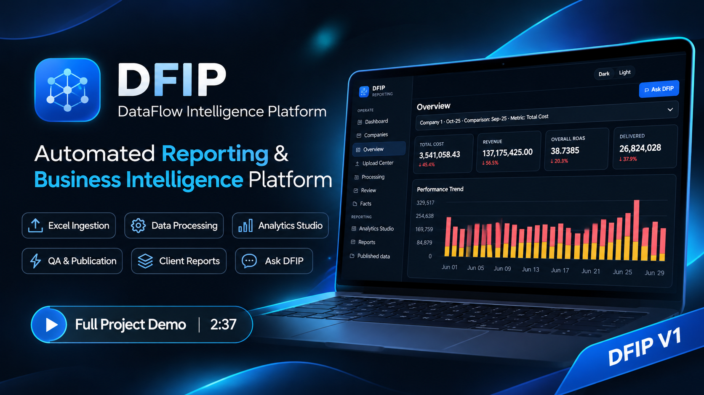
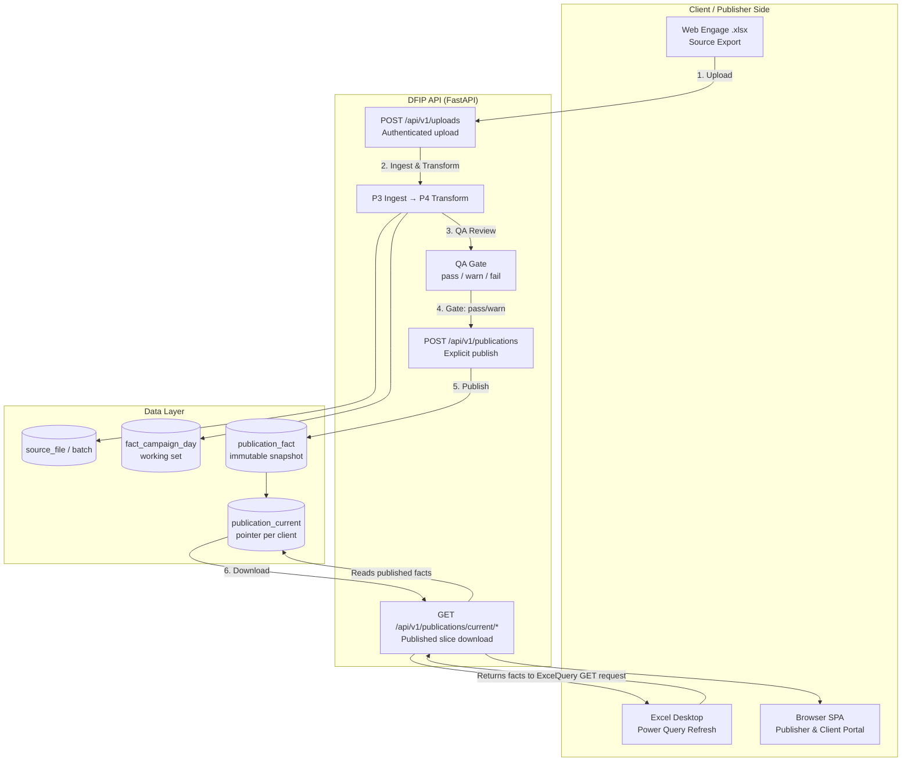

# DFIP — DataFlow Intelligence Platform

[](https://www.python.org/)
[](https://fastapi.tiangolo.com/)
[](https://www.postgresql.org/)
[](https://github.com/astral-sh/ruff)

DFIP is a platform designed to streamline and automate reporting workflows for Web Engage campaign data. Publishers upload source Excel workbooks; DFIP ingests, transforms, validates, and publishes a controlled dataset that client workbooks can refresh over a secure API. It replaces manual Excel / Power Query reconciliation with a staged pipeline: upload, ingest, transform, QA review, explicit publication, and download.

## Project Demonstration

[](https://www.youtube.com/watch?v=vjct1gDHOHI)

Watch the complete DFIP demonstration, covering data ingestion, processing, reporting automation and analytics.

## Overview

Campaign operations teams previously reconciled Web Engage raw exports by hand in Excel and Power Query. DFIP automates that pipeline: upload a `.xlsx` workbook, run it through a versioned ingest and transformation engine, review quality-assurance findings, explicitly publish an immutable snapshot, and let clients download reports or refresh them directly from Excel.

## Key Features

| Feature | Description |
|---------|-------------|
| Excel ingestion | Multipart `.xlsx` upload with ZIP/size validation, SHA-256 identity, and replay deduplication |
| P3 ingest pipeline | 57-column header contract validation, row staging, rejected-row tracking |
| P4 transformation | Campaign labels, template mapping, Filter Logic 1_2, rate cards, Total Cost, `fact_campaign_day` |
| Quality assurance | Deterministic QA verdict (pass / warn / fail / unavailable) per processing run |
| Explicit publication | Immutable `publication_fact` snapshot; `publication_current` pointer per client; upload does **not** auto-publish |
| Published downloads | CSV and XLSX of the published slice, row-capped |
| Client workbooks | Static Client Report (XLSX) and refreshable Client Report (XLSM) via Power Query |
| Historical reports | Per-publication snapshot downloads bound to `publication_id` |
| Overview dashboard | Eight hero KPIs with prior-month comparison |
| Key Insights | Deterministic insights: material change, dominant driver, signals, relationships |
| Anomaly Detection | Baseline-based anomaly detection on published history |
| Ask DFIP | Contextual QA over published history; deterministic intent classification, optional OpenAI/Gemini wording |
| Analytics Studio | Trends, explorer, drilldown, filters, saved analyses, CSV export |
| Client authentication | Password sign-in → HS256 JWT; publisher session lease; application-level authorization |


## Architecture



### Working Set vs. Published Facts

- **Working set** (`fact_campaign_day`): unpublished, inspector-only, reachable via `GET /api/v1/facts`.
- **Published facts** (`publication_fact` + `publication_current`): immutable snapshot, client-scoped, reachable via `GET /api/v1/publications/current/facts` and download endpoints.

Upload, transformation, QA, and publication are **separate stages**. Upload does not automatically publish.

## Technology Stack

| Layer | Technology |
|-------|------------|
| Backend | Python 3.11+, FastAPI, Pydantic 2 |
| Frontend | JavaScript (ES modules), HTML5, CSS3 |
| Authentication | PyJWT HS256, constant-time dev-token compare |
| Excel I/O | openpyxl 3 |
| Database | psycopg 3, PostgreSQL 16 (optional via `DATABASE_URL`; in-memory by default) |
| HTTP client | httpx |
| Testing | pytest 8 |
| Lint / Format | Ruff |
| Container | Docker |
| Production edge | Caddy (HTTPS, loopback upstreams) |

### Optional Integrations

- **OpenAI / Gemini**: LLM wording provider for Ask DFIP (server-side only; `DFIP_ASK_PROVIDER` must be set)
- **Excel Desktop**: Power Query (`PublishedFacts.m`) refreshes published facts from the API
- **Power BI**: Model, DAX, query, and SQL specifications exist under `powerbi/`; no `.pbix` is committed and Desktop integration is not verified

## Local Running

Start the API:

```powershell
$env:DFIP_ENV="development"
$env:DFIP_AUTH_MODE="dev_token"
$env:DFIP_DEV_AUTH_TOKEN="choose-a-local-token"
$env:DFIP_DEV_AUTH_ROLE="publisher"
python -m dfip_api
```

Start the web SPA:

```powershell
python -m dfip_web
```

The API runs on `http://127.0.0.1:8000`; the SPA runs on `http://127.0.0.1:3000` and calls the API at `DFIP_API_BASE_URL`. Copy `.env.example` to `.env` (gitignored, never committed) and review settings before running. Leave `DATABASE_URL` empty for in-memory stores.

## Excel Token Refresh

Power Query (`PublishedFacts.m`) reads `ApiBaseUrl` and `BearerToken` from the workbook Settings table and calls `GET /api/v1/publications/current/facts` with `Authorization: Bearer <token>`, paging `limit=200` until `total` is consumed. For refreshable workbooks, the download endpoint stamps a short-lived JWT into `BearerToken`. When the JWT expires but the workbook grant is still active, `POST /api/v1/auth/refresh` can renew it. After grant expiry, the client must re-download the workbook. The committed `excel/Client_Report.xlsx` template ships with an empty `BearerToken`.

## Workflow

1. **Upload** — Publisher submits a Web Engage `.xlsx` via `POST /api/v1/uploads`. Returns `202 Accepted`; poll batch and processing-run status.
2. **Ingest & Transform** — P3 validates headers and stages rows; P4 applies labels, templates, rate cards, and computes facts.
3. **QA & Review** — Each run receives a QA verdict. Publication is allowed only for `pass` or `warn`.
4. **Publish** — Explicit `POST /api/v1/publications` writes an immutable `publication_fact` snapshot and replaces the client's `publication_current` pointer.
5. **Download** — Clients download CSV/XLSX or a Client Report workbook from the published slice.

## Dashboards & Analytics

- **Overview (D1)**: Eight hero KPIs (Total Cost, Revenue, ROAS, Delivered, Clicks, Conversions, Delivery Rate, CTR) with prior-month comparison.
- **Key Insights (D6)**: Deterministic — not AI-generated. Material change, dominant driver, positive/negative signals, relationships.
- **Anomaly Detection (D7)**: Baseline-based detection on published history.
- **Ask DFIP (D8)**: Deterministic intent classification first; optional OpenAI/Gemini provider supplies wording only. The LLM never selects SQL, metrics, or tenants.
- **Analytics Studio (D9)**: Trends, explorer, drilldown, global filters, saved analyses, workspace CSV export.

## Testing & Linting

```powershell
python -m pytest
python -m ruff check packages tests
python -m ruff format --check packages tests
```

PostgreSQL-backed tests require `DFIP_TEST_DATABASE_URL` and are skipped without it.

## Security Considerations

- **Authentication**: `dev_token` for development/test only (refused in production); HS256 JWT via password sign-in otherwise. Tokens stored in `sessionStorage`, not `localStorage`.
- **Authorization**: Application-level role gating (`admin`, `publisher`, `reader`, `client`). This is **not** production tenant isolation via PostgreSQL RLS; RLS is defense-in-depth only when `DATABASE_URL` is set.
- **Secrets**: Never commit `.env`, JWT secrets, or API keys. Production-grade environments read container/process environment only.

## Limitations

| Area | Status |
|------|--------|
| Tenant isolation | Application-level only; not production PostgreSQL RLS isolation |
| Auto-publication | Not implemented — publication is an explicit step |
| Background worker | In-process `ThreadPoolExecutor`; no separate worker service |
| Object storage | Signed-URL download of source files not implemented |
| Power BI Desktop | Specifications only; no `.pbix`, Desktop integration not verified |
| Frontend tests | No dedicated JavaScript test suite for the SPA |

## Documentation

Full technical details are maintained in `documentation/`:

- [Architecture & Data Flow](documentation/V1_ARCHITECTURE.md)
- [API Reference](documentation/V1_API_REFERENCE.md)
- [Security Model](documentation/V1_SECURITY.md)
- [Deployment Runbook](documentation/V1_DEPLOYMENT.md)
- [Publication Workflow](documentation/PUBLICATION.md)
- [HTTP Workflow](documentation/HTTP_WORKFLOW.md)
- [Test Inventory](documentation/V1_TEST_INVENTORY.md)

## Repository

- **Repository**: https://github.com/IAmPrathamPatil/DFIP-V1
- **Issues**: https://github.com/IAmPrathamPatil/DFIP-V1/issues
- **Pull Requests**: https://github.com/IAmPrathamPatil/DFIP-V1/pulls
